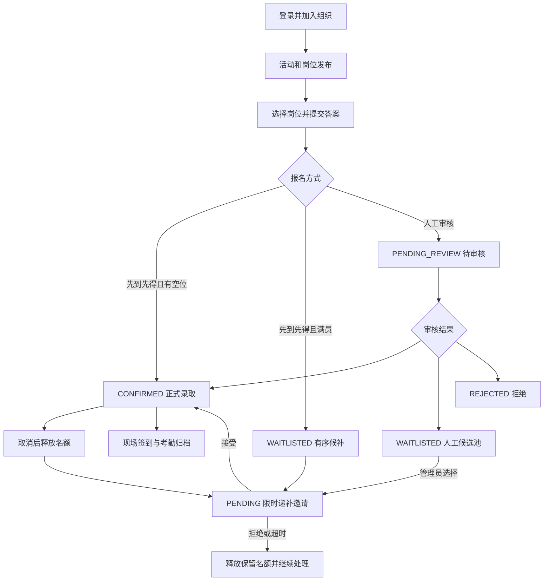
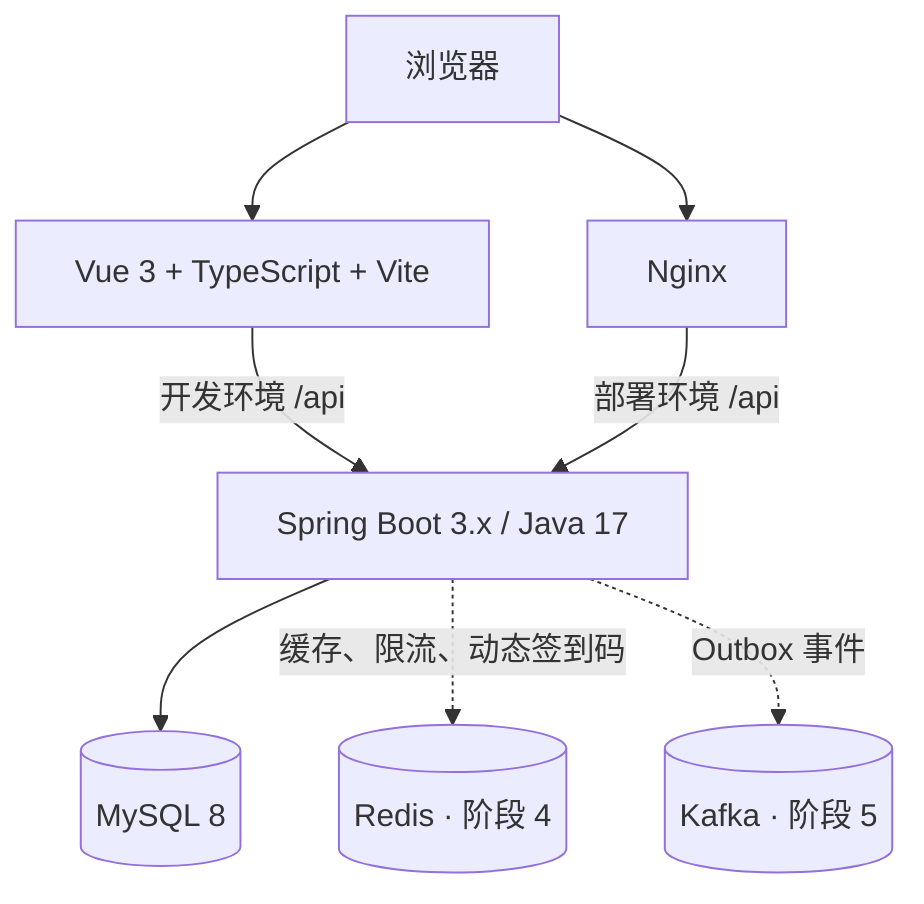

# VolunteerFlow

一个面向多组织的活动报名、候补、通知与签到协同平台。

## 为什么做这个项目

活动报名通常通过 QQ 群链接等即时通信渠道发布，实际协作中容易出现以下问题：

- 活动消息被群聊淹没，成员容易错过报名和变更通知。
- 活动包含礼仪、疏导、讲解等不同岗位，但普通报名表难以分别管理名额和要求。
- 名额满员后缺少公开、可验证的候补规则。
- 正式成员临时退出时，负责人往往只能通过私聊人工寻找替补。
- 报名名单、候补名单、签到表和通知分散在不同工具中。
- 现场签到和事后统计缺少统一的数据记录。

VolunteerFlow 将活动、岗位、报名状态、候补递补、通知和签到放在同一套业务流程中，让成员清楚了解自己的状态，也让负责人减少重复协调。

## 核心业务流程 + 状态机





每个活动可以包含多个志愿岗位，每个岗位独立设置人数、报名模式、问题和候补规则。
示例：

```text
新生开学典礼
├─ 礼仪岗：10 人，人工审核
├─ 疏导岗：20 人，先到先得
└─ 讲解岗：8 人，人工审核
```

同一成员在同一活动中只能报名一个岗位。如需换岗，必须先取消原报名，再报名新岗位；新岗位不继承原来的候补顺序。

## 功能范围

### 成员端

- 使用用户名和密码注册、登录，支持多设备独立会话。
- 通过邀请码加入组织。
- 在手机上浏览活动及岗位详情。
- 填写活动公共问题和岗位专属问题。
- 查看审核、录取、候补和递补邀请状态。
- 查看自己的候补名次和邀请倒计时。
- 接受或拒绝限时递补邀请。
- 主动取消报名并查看站内通知。
- 使用签到码完成活动签到。

### 管理端

- 创建组织并管理成员、邀请码、角色和权限。
- 创建、编辑、发布、变更、取消和结束活动。
- 为活动配置多个岗位及独立招募规则。
- 审核报名申请并管理无序候选池。
- 查看先到先得岗位的有序候补队列。
- 处理限时递补、签到场次和人工补签。
- 查看关键操作审计日志。

### 暂时不包含

- 支付、收费和退款。
- 地理围栏签到。
- 自动信用分、封禁或缺席处罚。
- 微服务拆分。
- 聊天室和 AI 功能。

聊天室、未读摘要、活动变更识别和资料问答将在核心版本稳定后作为下一版单独设计。

## 关键设计

### 岗位级招募

岗位是活动中的一级业务实体。每个岗位独立维护：

- 招募人数。
- `FIRST_COME`（先到先得）或 `REVIEW`（人工审核）模式。
- 岗位说明、服务时间和集合地点。
- 岗位专属报名问题。
- 候补队列或候选池。
- 递补邀请确认时限。

### 候补与名额预留

- 先到先得岗位按不可修改的候补序号自动递补。
- 人工审核岗位使用无固定顺序的候选池，由管理员选择递补成员。
- 递补邀请默认有效 2 小时，可配置为 30 分钟至 12 小时。
- 待确认邀请会暂时占用岗位名额，防止同一名额被重复分配。
- 拒绝或超时后释放名额；先到先得岗位自动处理下一人。

### 自定义 RBAC

- 平台预置稳定的权限编码。
- 每个组织可以配置自己的角色和权限组合。
- 每名组织成员在一个组织中只拥有一个角色。
- 创建组织时自动生成组织负责人、活动管理员和普通成员角色。
- 负责人角色始终拥有全部组织权限，且组织必须至少保留一名有效负责人。
- 所有关键授权变更都写入审计日志。

### 并发正确性优先

第一轮报名业务只依赖 MySQL，通过事务、行锁、唯一约束和状态条件更新保证：

- 岗位不超卖。
- 同一成员不重复报名同一活动。
- 邀请不能重复接受或过期后接受。
- 客户端重试不会生成重复有效记录。

Redis 在后续阶段作为缓存、限流、动态签到码和并发辅助，不作为最终正确性的唯一保证。Kafka 不进入报名主事务，只通过 Transactional Outbox 承载异步通知和领域事件。

## 技术架构



| 层级 | 技术 |
|---|---|
| 后端 | Java 17、Spring Boot 3.x、Spring Security 6 |
| 数据访问 | MyBatis-Plus、自定义 Mapper、Flyway |
| 前端 | Vue 3、TypeScript、Vite、Vue Router、Pinia、Axios |
| 数据库 | MySQL 8 |
| 工程增强 | Redis、Kafka、Transactional Outbox |
| 部署 | Docker Compose、Nginx |
| 测试 | JUnit 5、Testcontainers、Vitest、Playwright、k6 |
| 监控 | Actuator、Micrometer、Prometheus、Grafana |

```text
backend
├─ auth
├─ organization
├─ rbac
├─ activity
├─ registration
├─ checkin
├─ notification
├─ audit
└─ infrastructure
```

MyBatis-Plus 用于常规 CRUD、分页和条件查询；报名抢占、容量统计、候补递补和 `SELECT ... FOR UPDATE` 使用明确的自定义 SQL。Flyway 是数据库结构变更的唯一入口。

## 仓库结构

以下为 Git 已跟踪的目录概览（省略各模块内部文件）。GitHub 会将只有一层子目录的路径折叠显示，例如 `.superpowers/sdd` 和 `loadtest/stage4d`。

```text
VolunteerFlow/
├─ .superpowers/
│  └─ sdd/           # 开发任务与评审过程记录
├─ backend/          # Java 17 / Spring Boot 后端，使用 IDEA 开发
├─ deploy/           # 部署配置、Nginx、验收与升级工具
├─ docs/
│  ├─ design/        # 界面设计素材
│  ├─ operations/    # 运行、部署与验收操作手册
│  ├─ presentation/  # 项目设计演示文稿
│  ├─ reports/       # 验收报告与验证证据
│  ├─ specs/         # 正式设计规格
│  └─ superpowers/   # 分阶段设计与实施计划
├─ frontend/         # Vue 前端，使用 VS Code 开发
├─ loadtest/
│  └─ stage4d/       # k6 压测场景与公共脚本
├─ .dockerignore
├─ .gitattributes
├─ .gitignore
└─ README.md
```

`PROJECT_CONTEXT.md` 是本地交接文件，已加入 `.gitignore`，不属于远程仓库内容，因此不在目录树和公开文档链接中列出。`backend/target/`、`frontend/node_modules/`、`frontend/dist/` 及私有运行配置也不属于上述源码目录概览。

当前仓库包含 `backend/`、`frontend/`、Nginx 配置、外部 MySQL 两服务 Compose、冒烟脚本和 Playwright 场景。具体操作与验证边界见[阶段 3 演示部署操作手册](docs/operations/stage-3-demo-deployment.md)。

## 开发路线

| 阶段 | 主要目标 |
|---|---|
| 阶段 0 | 前后端工程、完整数据库迁移、MySQL Compose、统一错误与健康检查 |
| 阶段 1 | 认证、组织、邀请码、自定义 RBAC、活动与岗位 |
| 阶段 2 | 两层报名表、两种报名模式、候补/候选池、递补和审计 |
| 阶段 3 | 站内通知、签到、Nginx 和首次部署 |
| 阶段 4 | Redis、动态签到码、限流、缓存和并发压测 |
| 阶段 5 | Kafka、Outbox、幂等消费和补偿任务 |
| 阶段 6 | 自动化测试、监控、备份恢复和真实试用 |

## 本地运行

后端 IDEA 启动说明和阶段 1 API 见 [backend/README.md](backend/README.md)。本地开发方式：

```text
1. 在 IDEA 中运行 Spring Boot 后端（默认端口 8080）
2. 在 VS Code 终端进入 frontend
3. 执行 npm install 和 npm run dev
4. 访问 http://localhost:5173，前端通过 Vite 代理访问 /api 与 /actuator
```

回归命令：后端执行 `.\mvnw.cmd clean verify`；前端依次执行 `npm test`、`npm run typecheck` 和 `npm run build`。

演示部署使用仓库根目录的 `deploy/`，不会创建或管理 MySQL。复制 `deploy/.env.example` 为被 Git 忽略的 `deploy/.env`，填写容器可达的外部 MySQL 地址、真实端口、标准 Base64 JWT 密钥及明确的 Flyway 策略后再执行。恢复库示例使用 `SPRING_FLYWAY_ENABLED=false`，但必须先核对库结构与 `flyway_schema_history`；全新数据库不能直接沿用该值。所有 Compose 操作统一通过 `deploy/run-stage3-stack.ps1`，脚本会隔离调用者已有的同名环境变量；E2E wrapper 当前要求 Windows PowerShell、Java 17、Node.js 22.13.0 或更高版本、npm 和 Chromium，并保证 Compose 与 Maven fixture 使用同一份环境文件。完整命令、安全边界、停止和回滚步骤见[阶段 3 演示部署操作手册](docs/operations/stage-3-demo-deployment.md)。

## 文档

- [阶段 5 Kafka / Outbox 操作手册（静态工具链，真实迁移/故障恢复尚未验收）](docs/operations/stage-5-kafka-outbox.md)
- [阶段 3 演示部署操作手册](docs/operations/stage-3-demo-deployment.md)
- [阶段 4B–4C Redis 动态签到与限流操作手册](docs/operations/stage-4-redis.md)
- [阶段 4D 真实部署与压测操作手册](docs/operations/stage-4d-live-load-test.md)
- [阶段 4D 真实部署与压测报告](docs/reports/2026-10-17-stage-4d-live-load-test.md)
- [阶段 4D 实测报告模板](docs/reports/stage-4d-report-template.md)
- [修订版完整设计规格](docs/specs/2026-09-14-volunteerflow-revised-design.md)
- [早期设计规格](docs/specs/2026-08-06-campus-volunteer-platform-design.md)
- [项目设计演示文稿](docs/presentation/VolunteerFlow校园志愿活动平台完整设计.pptx)

## 开发约定

- 所有数据库结构修改必须新增 Flyway 迁移，不手工修改共享数据库。
- 密码、令牌、数据库凭据和其他密钥不得提交到 Git。
- 后端不能依赖前端隐藏按钮进行权限控制。
- 业务查询必须同时限制当前用户、组织和资源归属。
- 核心数据通过状态停用或取消，不物理删除。
- 关键业务修改需同步补充自动化测试与文档。

## 最近完善：个人账号与草稿管理

- **个人资料**：在“我的资料”中修改姓名、联系方式；用户名、学号和平台身份只读。后端从登录主体确定用户，不接受客户端指定用户 ID 或修改角色。
- **修改密码**：验证当前密码，新密码为 12–72 个字符且 UTF-8 编码不超过 72 字节。成功后撤销该用户全部刷新会话，并递增凭据版本，使旧 JWT 立即失效；所有设备需重新登录。资料更新不影响凭据版本。
- **草稿管理**：组织活动页进入“草稿管理”，从服务端分页加载草稿，不再依赖浏览器 localStorage 保存的最近草稿 ID。仅拥有本组织 `activity:create` 权限的成员可读取、编辑草稿。
- **岗位编辑与删除**：发布前可修改岗位人数、报名方式、服务时间和集合地点，支持清空可选字段；删除为 `DELETED` 逻辑删除，不物理删除岗位或历史问题。删除后的岗位不参与公开读取、表单配置和发布校验；原岗位名称仍受唯一约束保护，重复使用会产生冲突。
- **发布边界**：活动至少有一个有效岗位，且活动、岗位、问题的未保存编辑均处理完毕后，前端才允许发布。后端锁定活动后再锁岗位，复核草稿状态；已发布活动不能调用草稿岗位修改接口。

| 本轮接口 | 用途 |
|---|---|
| `PUT /api/v1/auth/me` | 更新当前用户姓名、联系方式 |
| `POST /api/v1/auth/password` | 修改密码、撤销旧会话，返回 204 并清除刷新 Cookie |
| `GET /api/v1/organizations/{id}/activity-drafts?page=1&size=20` | 组织草稿分页，按活动更新时间和 ID 倒序排列 |
| `GET /api/v1/activities/{id}/draft` | 专用草稿详情，不要求额外授予公开活动读取权限 |
| `PUT /api/v1/positions/{id}/draft` | 替换草稿岗位配置，显式保存可选空值 |
| `DELETE /api/v1/positions/{id}/draft` | 逻辑删除草稿岗位 |